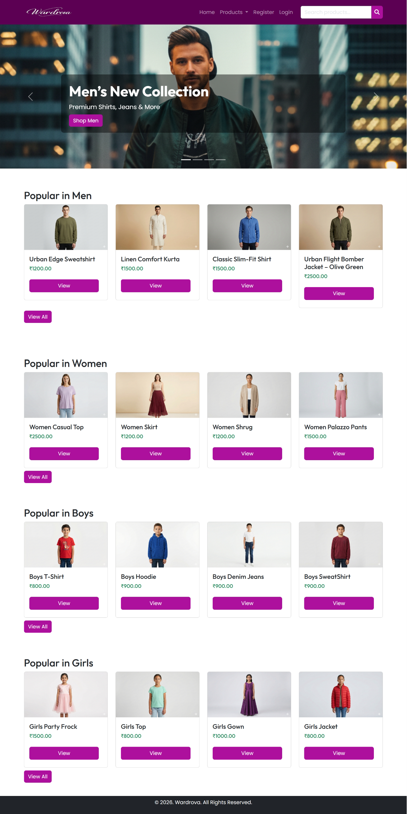
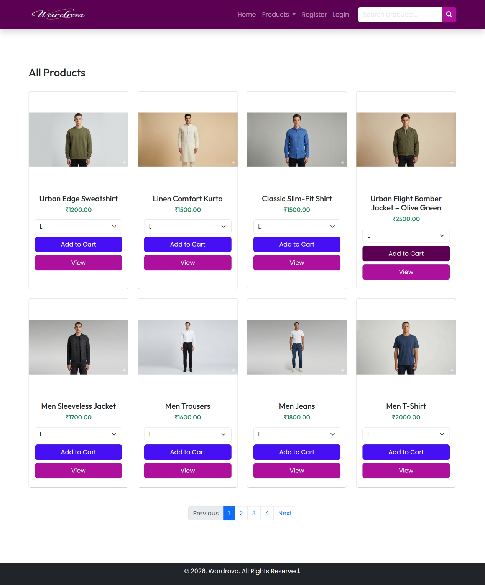
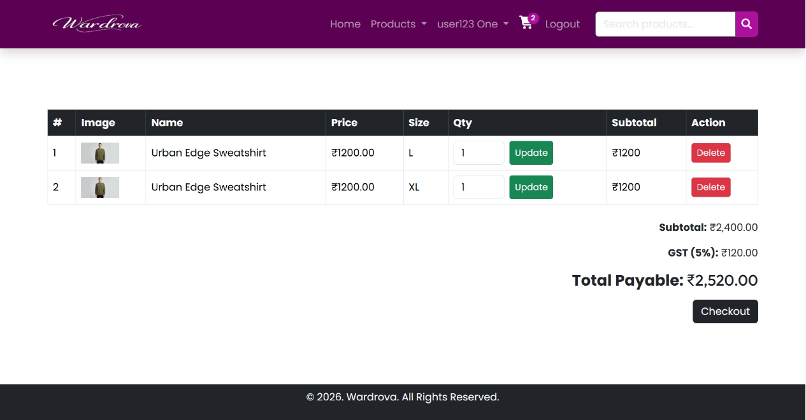
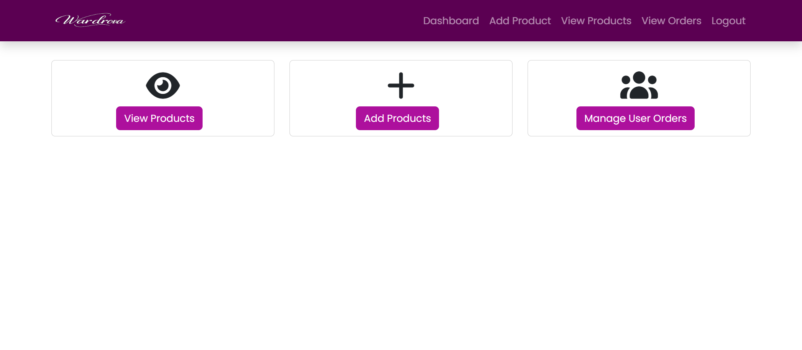

# Wardrova – Online Fashion E-Commerce Website

Wardrova is a clothing e-commerce website developed as an MCA academic project. It provides a platform for customers to browse clothing products, manage a shopping cart, place orders, and view their orders. It also includes an admin area for managing products and orders.

## Project Overview

- **Project type:** MCA academic mini project
- **Domain:** Fashion / E-commerce
- **Backend:** PHP
- **Database:** MySQL
- **Frontend:** HTML, CSS, JavaScript, Bootstrap

## Technologies Used

- HTML
- CSS
- JavaScript
- Bootstrap
- PHP
- MySQL

## Features

### Customer Features
- Browse clothing products and product details
- View products by category and search for products
- Register and log in to an account
- Add products to the shopping cart
- Proceed through checkout and place orders
- View order status/details and order history
- Access profile-related functionality
- Cancel orders, where supported by the application

### Admin Features
- Access the admin dashboard
- Add, edit, and delete products
- View and manage the product list
- View orders and order details
- Manage product images

## Project Structure

The main files and folders in the repository are organized as follows:

```text
wardrova/
├── admin/
│   ├── includes/
│   │   ├── header.php
│   │   └── footer.php
│   ├── add_product.php
│   ├── code.php
│   ├── dashboard.php
│   ├── delete_product.php
│   ├── edit_product.php
│   ├── index.php
│   ├── logout.php
│   ├── order_details.php
│   ├── orders.php
│   ├── product_image_delete.php
│   └── product_list.php
├── assets/
│   ├── css/
│   │   └── style.css
│   └── js/
│       └── script.js
├── db/
│   ├── wardrova_v1.sql
│   ├── wardrova_v2.sql
│   └── wardrova_v3.sql
├── images/
│   ├── products/
│   ├── resources/
│   ├── logo.png
│   ├── logo1.png
│   ├── logo2.png
│   ├── slider-boys.png
│   ├── slider-girls.png
│   ├── slider-men.png
│   └── slider-woman.png
├── includes/
│   ├── db_con.php
│   ├── footer.php
│   └── header.php
├── screenshots/
│   ├── admin-dashboard.png
│   ├── admin-list.png
│   ├── billing.png
│   ├── cart.png
│   ├── class-diagram-e-commerce.avif
│   ├── class-diagram-e-commerce.png
│   ├── home.png
│   ├── login.png
│   ├── online-shopping-uml-sequence-diagram-.jfif
│   ├── orders.png
│   ├── product-category.png
│   ├── product-detail.png
│   ├── products.png
│   ├── register.png
│   ├── search-results.png
│   ├── success.png
│   └── use-case-example-online-shopping.png
├── add_to_cart.php
├── cancel_order.php
├── checkout.php
├── code.php
├── index.php
├── login.php
├── logout.php
├── my_cart.php
├── my_profile.php
├── order_success.php
├── orders.php
├── place_order.php
├── product-detail.php
├── products.php
└── register.php
```

## Getting Started

### Prerequisites

- [XAMPP](https://www.apachefriends.org/) or another local environment that provides Apache, PHP, and MySQL
- A web browser

### Setup Instructions

1. Download or clone this repository.
2. Place the `wardrova` project folder in XAMPP's `htdocs` directory.
3. Open the XAMPP Control Panel and start **Apache** and **MySQL**.
4. Open phpMyAdmin, usually at `http://localhost/phpmyadmin`.
5. Review `includes/db_con.php` to identify the database name and connection settings expected by the application.
6. Import the SQL file that matches your project database. The `db/` folder contains `wardrova_v1.sql`, `wardrova_v2.sql`, and `wardrova_v3.sql`; use the version that corresponds to your application rather than importing all versions into the same database.
7. Update the database connection settings in `includes/db_con.php` for your local MySQL configuration.
8. Open the project in your browser at `http://localhost/wardrova/` (adjust the URL if you use a different folder name).

> **Note:** The database name and SQL schema must match the settings and queries used by the PHP files. If the application does not run after setup, check the database connection details and import the matching SQL version.

## Screenshots

### Home Page


### Product Listing


### Shopping Cart


### Admin Dashboard


## Security Notes

- Do not publish real passwords or private credentials.
- Use local development credentials and update them for your own environment.
- Do not commit real customer or other sensitive personal data to the repository.

## Academic Project

Wardrova was developed as part of an MCA academic project to apply web development, server-side programming, and database integration concepts in an e-commerce application.

## Author

**Anirudh Bantaram**
